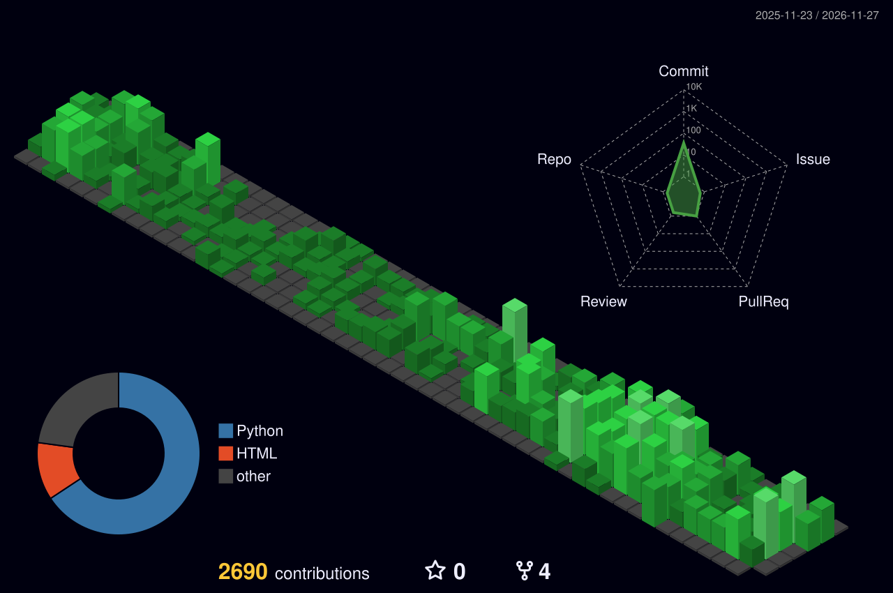

<h1 align="center">Ayyappa Swamy Thati</h1>

<strong>Senior AI &amp; Systems Engineer</strong>

Model building · Intelligent systems · Data-driven products

  <a href="https://ayyappaswamy-sam.github.io/">Portfolio</a> &nbsp; / &nbsp;
  <a href="https://www.linkedin.com/in/ayyappa-swamy-thati-82372a222">LinkedIn</a> &nbsp; / &nbsp;
  <a href="mailto:thatiayyappaswami@gmail.com">Email</a>

---

I build across the AI lifecycle: from training and adapting models to designing the systems that make them useful. My work spans language models, machine learning, computer vision, reinforcement learning, robotics, and production AI products.

## Areas of expertise

**Language models & AI systems** 
LLMs from scratch and fine-tuning · BERT and NLP · RAG · multi-agent systems · knowledge graphs

**Machine learning & data science** 
Supervised and unsupervised learning · statistical modeling · clustering · time series · model evaluation

**Deep learning, vision & robotics** 
CNNs and representation learning · object detection and tracking · reinforcement learning · ROS

**Engineering** 
Python · Go · SQL · FastAPI · PyTorch · TensorFlow · LangGraph · DuckDB · PostgreSQL · Docker · cloud

Explore more projects and background on my [portfolio](https://ayyappaswamy-sam.github.io/) and [GitHub repositories](https://github.com/AyyappaSwamy-Sam?tab=repositories).

## GitHub activity

  

  

